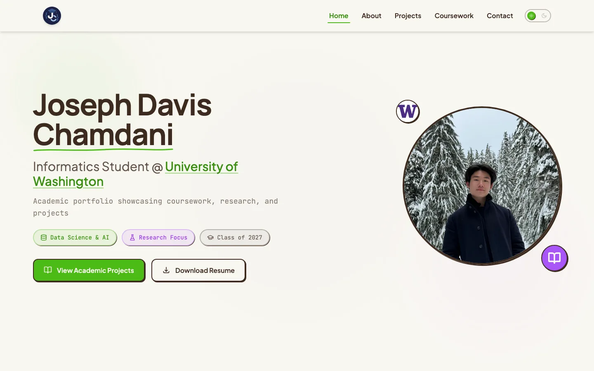
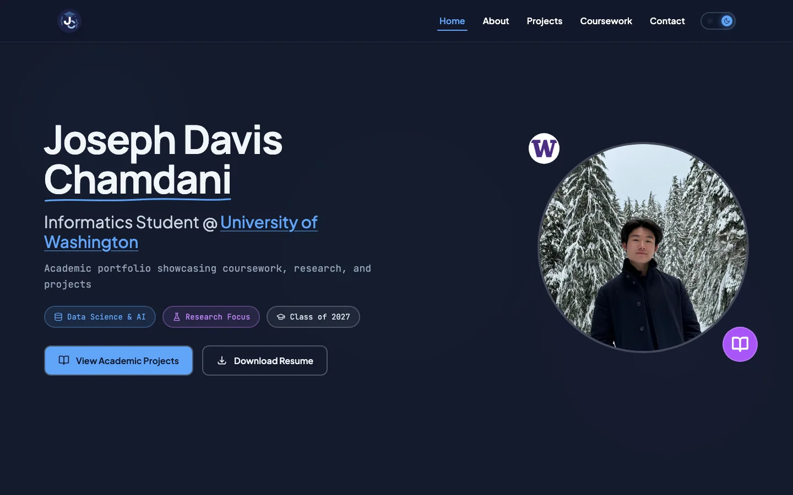

# Academic Portfolio

Academic portfolio of Joseph Davis Chamdani, Informatics student at the University of Washington. The site presents coursework from UW and Bellevue College, academic projects, and research work in data science, AI, and human computer interaction.

- Live site: [uw.joechamdani.com](https://uw.joechamdani.com)
- Personal portfolio: [joechamdani.com](https://joechamdani.com)

| Light | Dark |
|-------|------|
|  |  |

## Tech Stack

| Layer | Choice |
|-------|--------|
| Framework | React 18 with TypeScript |
| Build tool | Vite |
| Styling | Tailwind CSS (class based dark mode) |
| Animations | Framer Motion |
| UI components | Radix UI (shadcn/ui) |
| Routing | React Router DOM v6 |
| SEO | react-helmet-async |
| Forms | react-hook-form with zod validation |
| Hosting | Hostinger, deployed over FTP |

## Features

- Dual theme neobrutalist design system shared with joechamdani.com: paper white with court green accents in light mode, deep slate with neon blue accents and glassmorphism cards in dark mode
- Theme toggle with localStorage persistence and a flash prevention script in index.html
- Coursework grouped by quarter, with an expandable list of all Bellevue College courses
- Academic project cards for INFO 200, 201, 300, 340, 360, 380, and 498 with GitHub and live demo links
- Contact form posting to a shared PHP backend on the main portfolio
- Structured data (Schema.org), Open Graph tags, and page level meta via react-helmet-async
- Security headers (HSTS, CSP, Permissions-Policy) configured in .htaccess

## Project Structure

```
src/
  components/
    sections/        Hero, About, Portfolio, Coursework, Contact
    shared/          Navbar, Footer, ContactForm, theme and scroll components
    ui/              shadcn/ui primitives
  context/           ThemeContext (localStorage key: uw-joechamdani-theme)
  pages/             Index, ProjectInfo300, NotFound
  lib/               Utilities

public/
  projects/          Project images and static report pages (INFO 201, INFO 300)
  logos/             School and company logos
  media/             Resume and site previews
  cursors/           Custom cursor assets

scripts/
  deploy-ftp.js      FTP deployment with retries and reconnect logic
```

## Routes

| Route | Page |
|-------|------|
| `/` | Homepage with all sections |
| `/projects/INFO_300/` | INFO 300 research proposal |
| `/projects/INFO_201/final_report_group_2` | INFO 201 final report (static HTML) |

## Development

```bash
npm install
npm run dev      # dev server on port 8080
npm run build    # production build with code splitting
```

The contact form relies on the main portfolio's backend at joechamdani.com/api/contact.php and requires no local configuration.

## Deployment

```bash
npm run deploy   # build, then upload to Hostinger over FTP
```

Deployment reads credentials from `scripts/ftp-config.json`, which is not committed. The build is split into vendor chunks (see `vite.config.ts`) to keep individual FTP uploads small.

## License

Content and design are personal work. Feel free to reference the code, but please do not republish the content as your own.
